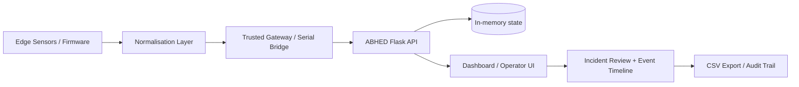
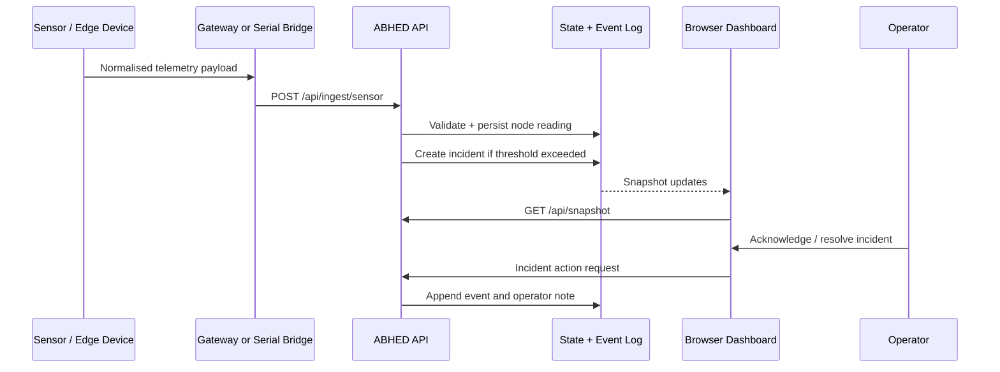

# ABHED Field Awareness Platform

[](https://www.python.org/) [](LICENSE)

ABHED is a field-awareness and operator-monitoring platform for distributed sensor nodes, designed to help teams review live or simulated environmental activity, understand node health, and triage incidents with a clear operational view.

This repository provides a working Flask-based dashboard, normalised sensor ingestion endpoints, event logging, simulation utilities, and an operator workflow for acknowledging or resolving candidate incidents.

> Important: the default application starts in demo simulation mode. The displayed nodes, readings, and incidents are sample data and are not operational evidence.

## Overview

ABHED brings together:

- sensor node health and telemetry summaries
- a schematic field map with node connectivity
- incident candidate detection and review workflows
- event history and CSV export for audits
- an API contract for normalised sensor ingestion
- a local simulation environment for testing and demonstrations

The system is intended as an operational prototype and integration scaffold for field deployments, not as a standalone safety-critical system.

## Core capabilities

- Operations overview with availability, health, and incident indicators
- Schematic map for node visibility and logical connectivity
- Normalised reading model for sensor inputs from edge devices or gateways
- Incident lifecycle: open, acknowledge, resolve, note, export
- Event timeline for operator and system actions
- Configurable UI settings for refresh rate, confidence threshold, and simulation mode
- Flask API with validation and authenticated sensor ingestion
- JSON-lines serial bridge for devices already producing normalised payloads

## Architecture





## Repository structure

```text
.
├── abhed_app/
│   ├── routes.py              # Flask routes and API logic
│   ├── simulator.py           # Demo simulation and telemetry generation
│   ├── state.py               # In-memory node/incident/event state
│   ├── static/                # CSS, JavaScript, static assets
│   └── templates/             # Dashboard HTML templates
├── docs/
│   ├── api.md                 # API reference and payload examples
│   ├── architecture.md        # Design notes and deployment guidance
│   ├── hardware-integration.md
│   └── openapi.yaml           # OpenAPI spec
├── scripts/
│   ├── publish_sample.py      # Example sensor publisher
│   └── serial_bridge.py       # JSON-lines serial adapter
├── tests/
│   └── ...                    # API and workflow validation tests
├── .env.example               # Sample environment file
├── requirements.txt           # Python dependencies
├── run.py                     # Application startup entry point
├── LICENSE                    # MIT license
├── README.md                  # Project documentation
├── SECURITY.md                # Security reporting guidance
├── Makefile                   # Common local commands
└── state/                     # Local runtime state or temporary artifacts
```

## Quick start

Requirements: Python 3.10+

### Windows (PowerShell)

```powershell
cd ABHED_Field_Awareness_Platform
py -m venv .venv
.\.venv\Scripts\Activate.ps1
python -m pip install --upgrade pip
pip install -r requirements.txt
Copy-Item .env.example .env
```

Update `.env` before sending live data, especially `ABHED_INGEST_API_KEY`.

```powershell
python run.py
```

Open http://127.0.0.1:5000 in your browser.

### Linux / macOS

```bash
cd ABHED_Field_Awareness_Platform
python3 -m venv .venv
source .venv/bin/activate
python -m pip install --upgrade pip
pip install -r requirements.txt
cp .env.example .env
```

Then start the application:

```bash
python run.py
```

## Configuration

The project uses environment variables for local configuration. The defaults are suitable for a demo environment, but production or field deployment should use stronger configuration controls.

| Variable | Default | Description |
|---|---|---|
| `ABHED_HOST` | `127.0.0.1` | Bind address |
| `ABHED_PORT` | `5000` | HTTP port |
| `ABHED_DEBUG` | `false` | Flask debug mode |
| `ABHED_SIMULATION` | `true` | Enables demo telemetry generation |
| `ABHED_INGEST_API_KEY` | placeholder | Secret required for authenticated sensor writes |
| `ABHED_SITE_NAME` | `ABHED Field Operations` | Display name in the UI and API metadata |
| `ABHED_DETECTION_THRESHOLD` | `0.72` | Incident candidate threshold |

## Sensor ingestion and event flow

1. A node or gateway normalises a sensor reading into the project schema.
2. A trusted client posts to `POST /api/ingest/sensor` with the correct API key.
3. The backend validates the payload, updates node state, and appends an event.
4. If the reading exceeds the configured threshold and a similar candidate is not already open, an incident record may be created.
5. The operator can acknowledge or resolve the candidate and add a note.
6. Event history can be reviewed in the UI and exported to CSV.

### Example publisher

```bash
# Windows PowerShell
$env:ABHED_INGEST_API_KEY="your-secret"
python scripts/publish_sample.py --node ABH-N01 --sensor mmWave --value 5.4 --unit m
```

### Serial bridge

For hardware already producing one valid JSON object per line:

```bash
python scripts/serial_bridge.py --port COM5 --baud 115200
# Linux example: python scripts/serial_bridge.py --port /dev/ttyACM0 --baud 115200
```

This helper does not replace device-specific sensor acquisition or calibration logic; it passes through an already-normalised payload.

## API reference

| Method | Endpoint | Purpose |
|---|---|---|
| `GET` | `/api/health` | Health and version probe |
| `GET` | `/api/snapshot` | Dashboard data snapshot |
| `GET` | `/api/nodes` | Node registry and telemetry |
| `POST` | `/api/nodes` | Register a node |
| `GET` | `/api/incidents?status=active` | Get incident candidates |
| `POST` | `/api/incidents/{id}/acknowledge` | Acknowledge an incident |
| `POST` | `/api/incidents/{id}/resolve` | Resolve an incident with a note |
| `GET` | `/api/events?limit=50` | Recent event trail |
| `GET` | `/api/export/events.csv` | Export the event log |
| `GET` / `PUT` | `/api/config` | Read or update local configuration |
| `POST` | `/api/nodes/{id}/self-test` | Run a software-level self-test |
| `POST` | `/api/ingest/sensor` | Authenticated ingestion of a sensor payload |

See [`docs/api.md`](docs/api.md) for payload validation details and examples.

## Demo mode and operational cautions

This project intentionally ships with a visible demo state to make testing and UI review easy.

- Node positions and readings are illustrative, not geographic truth.
- Incident candidates are not verified operational alerts.
- The simulation is not a substitute for calibrated field devices.
- Self-tests validate software flow, not physical sensor alignment or environmental conditions.
- In-memory state is not durable; an app restart clears runtime data.

## Deployment and hardening guidance

ABHED is structured as a prototype and integration scaffold. Before any real-world deployment, operators should consider:

- persistent storage for readings and events
- user authentication and roles
- TLS termination and encrypted transport
- device-level credential rotation and node scoping
- audit retention and backup plans
- rate limits and abuse monitoring
- sensor validation against ground truth and calibration procedures
- privacy and cyber-security review for the target environment

## Testing

```bash
pytest -q
```

## Contributing

Contributions are welcome. For bug fixes, feature additions, or API changes:

1. create a feature branch
2. update or add tests where relevant
3. verify the local project behavior with the existing test suite
4. open a pull request with a clear summary of changes

## Security

Please report security issues privately in accordance with [`SECURITY.md`](SECURITY.md). Do not disclose vulnerabilities publicly before a remediation path has been established.

## License

This project is licensed under the MIT license. See [`LICENSE`](LICENSE).
